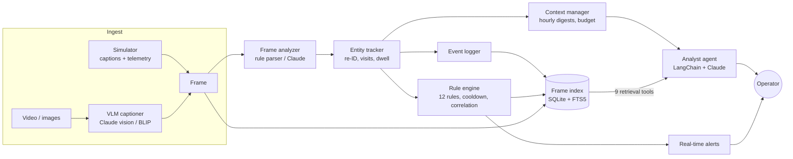

# Drone Security Analyst Agent

A prototype security analyst for a **docked drone that patrols one property every day**. It ingests drone telemetry and video frames, turns each frame into structured detections, tracks who and what comes and goes across the day, raises real-time security and flight-safety alerts, indexes every frame for search, and answers operator questions through a LangChain + Claude agent.

```
[02:14] ALERT  CRITICAL Masked person in black jacket climbing with bolt cutters at back fence, 02:14.
[12:00] LOG    Blue Ford F150 spotted at garage, 12:00.
[12:00] ALERT  LOW      Blue Ford F150 entered twice today (09:14, 12:00), 12:00.

you> How many times did the blue Ford F150 enter today?
Blue Ford F150 (V-002) made 3 visits with 7 sightings: 09:14-09:40 (main gate, garage),
12:00-12:20 (garage, main gate), 16:45-17:00 (main gate, garage).
you> When did it leave?
Blue Ford F150 was seen leaving at 09:40, 12:20. After its 16:45 arrival it was last seen
at 17:00 at the garage (no exit observed).
```

| | |
|---|---|
| **Feature spec** | [docs/FEATURE_SPEC.md](docs/FEATURE_SPEC.md): value to property owners and the key requirements |
| **Architecture** | [docs/ARCHITECTURE.md](docs/ARCHITECTURE.md): system diagram, per-frame sequence, data model, design decisions |
| **Testing** | [docs/TESTING.md](docs/TESTING.md): 87 automated tests, scenarios, benchmark results |
| **Report** | [docs/REPORT.md](docs/REPORT.md): approach, assumptions, tool choices, results, future work |
| **Demo videos** | [docs/DEMO_SCRIPT.md](docs/DEMO_SCRIPT.md): what each recording shows |

---

## What it does

| Requirement | How it is met |
|---|---|
| Process telemetry + video frames | Simulated feed (`data/scenarios/demo_day.json`: a scripted 24 h patrol with GPS, altitude, battery, wind) **and** real footage via VLM captioning (`video` command) |
| Identify objects/events, log them with context | Caption → structured detections (category, label, colour, make/model, clothing, carried items, action, zone) → **entity tracker** that re-identifies the same truck or person across frames and counts visits |
| Real-time alerts from predefined rules | 12 rules (8 security, 4 flight-safety) with severities, recommended actions, **cooldown de-duplication** and **alert correlation** |
| Frame-by-frame indexing | SQLite + **FTS5**: every frame with telemetry, detections, entities, logs and alerts; query by time, object, zone, entity or free text |
| Agent | LangChain `create_agent` + Claude with 9 retrieval tools and **budgeted working memory**; deterministic offline analyst when no API key is set |
| Bonus: video summary | One-sentence summary + highlights (`summary`), optional Claude-written briefing |
| Bonus: follow-up questions | `chat`: multi-turn Q&A with conversation memory ("when did *it* leave?") |

## Quick start

Requires Python 3.10+. **The core runs on the standard library alone**, so you can try it before installing anything:

```bash
git clone https://github.com/aviraj1805/FlytBase-AI-Engineer-Assignment.git
cd FlytBase-AI-Engineer-Assignment

python -m drone_security run                 # process the demo day: live logs + alerts, builds data/runs/latest.db
python -m drone_security chat                # ask questions about the footage
```

Full setup (LLM agent, Claude perception, tests):

```bash
python -m venv .venv
source .venv/bin/activate                    # Windows: .venv\Scripts\activate
pip install -r requirements.txt
pip install -r requirements-vlm.txt          # optional: real video + local BLIP captioning

export ANTHROPIC_API_KEY=sk-ant-...          # Windows PowerShell: $env:ANTHROPIC_API_KEY="sk-ant-..."
python -m pytest                             # 87 tests, ~3 s, no network needed
```

Without `ANTHROPIC_API_KEY` every command still works: the agent falls back to the offline analyst and perception uses the rule-based parser. With a key, `ask`/`chat` use the Claude agent automatically.

## Commands

```bash
python -m drone_security run [--speed 60] [--verbose] [--analyzer claude] [--scenario FILE]
python -m drone_security query --label truck                       # "show all truck events"
python -m drone_security query --category person --zone main_gate --from 00:00 --to 06:00
python -m drone_security query --text "masked fence"               # BM25 full-text search
python -m drone_security alerts --min-severity HIGH
python -m drone_security ask "What objects were in the video?"
python -m drone_security chat                                      # multi-turn, follow-ups
python -m drone_security summary [--llm]                           # 1-sentence summary + recommendations
python -m drone_security context --budget 3000                     # the agent's working memory
python -m drone_security video clip.mp4 --captioner claude --zone main_gate --every 2
python -m drone_security benchmark --frames 100000                 # scalability test
```

- `--speed 60` replays the feed in real time at 60x (one footage minute per second); `--verbose` also prints every frame with its telemetry.
- `--analyzer claude` uses Claude structured outputs instead of the rule parser for frame analysis.
- Scenarios can also be plain text in the brief's format: `Time: 00:01, Location: Gate, Frame 1: Person loitering at gate` (`.txt` file).

## Architecture in one picture



Details, sequence diagram, data model and the reasoning behind each choice: [docs/ARCHITECTURE.md](docs/ARCHITECTURE.md).

## Key design decisions

1. **Language-first pipeline.** Every frame becomes a caption first (simulated, or from a VLM), and everything downstream works on captions + telemetry. Simulated and real footage share one code path, and the VLM can be swapped (Claude vision ↔ BLIP) without touching tracking, rules or indexing.
2. **Deterministic core, LLM at the edges.** Detection parsing, tracking, rules and indexing are deterministic and run at ~3,000+ frames/s on a laptop with no network, which is what a dock's edge computer needs for real-time alerts. Claude is used where language understanding pays off: messy captions, image captioning, summaries and open-ended questions. Each LLM component has a deterministic fallback, so a network or API failure degrades answers but never stops alerting.
3. **Identity over boxes.** A docked drone's value is in *what repeats*: "the same truck came back three times", "the same person has been at the gate for six minutes". The tracker re-identifies entities by appearance signature and segments visits by observed enter/exit behaviour, because a time gap alone is unreliable with sparse patrol sampling (a bug found and fixed during development, see the report).
4. **Alerts that stay actionable.** Cooldowns suppress repeats (10 on the demo day; ~49k across 100k random frames), correlation folds overlapping rules into one alert per entity per frame, every alert carries a recommended action, and whitelists (the property manager's Camry, the yellow forklift) and uniformed staff never alert.
5. **Two-tier agent memory.** The prompt gets a character-budgeted working memory (alerts, key entities, hourly digests, latest frames); the agent reaches everything else through tools over the index. Context stays bounded however long the footage is.
6. **SQLite + FTS5 for the index.** It is embedded and serverless, ships with Python, handles 100k frames in 80 MB with sub-millisecond structured queries, and its schema maps directly to Postgres/pgvector for a multi-site cloud deployment.

## AI tools used and their impact

This project was built with **Claude Code (Claude Opus 5.5)** as the primary development tool, working from the assignment brief:

| Stage | What the AI tool did | Human review / outcome |
|---|---|---|
| Design | Proposed the language-first pipeline, two-tier agent memory and SQLite/FTS5 index; drafted the architecture diagrams | Architecture reviewed against the requirements; edge/offline constraint kept as a driver |
| Generated components | **Caption lexicon + parser**, **the 12 alert rules** (severities, messages, recommended actions), the simulator and the demo-day scenario, the agent tools and prompts | Rules and thresholds reviewed and moved into `config/property.json` |
| Debugging | Smoke runs exposed real bugs that were then fixed: visit counting ("entered twice" fired when the truck *left*), negation across lists ("no vehicles or people"), a correlated alert re-firing on the next frame, colour bleeding between objects, the drone detecting itself in "drone docked" captions | Each fix is pinned by a regression test |
| API correctness | Checked the Anthropic SDK and LangChain source on GitHub to confirm current signatures (`beta.messages.parse` with `output_format` + `fallbacks`, `ChatAnthropic(effort=...)`, `create_agent(system_prompt=...)`) rather than relying on memory | Avoided two stale patterns (effort via `model_kwargs` is now rejected; forced `tool_choice` returns 400 on Opus 5.5) |
| QA | Generated the 87-test suite from the spec (sample outputs, midnight vs noon alerts, cooldowns, persistence, scalability) | All tests pass in ~3 s |
| Docs | Drafted README, spec, architecture, testing notes, report and demo script | |

Impact: the full prototype (about 3,700 lines of Python, 740 lines of tests, and the docs) was built in one working session. The most valuable part was not code generation itself but the fast loop of *generate → run the demo → read the output → fix*: most design improvements came from reading real pipeline output.

## Claude API configuration

- Model: `claude-opus-5-5` (override with `DSA_MODEL`). Effort is set explicitly: `low` for per-frame extraction and captions, `medium` for the agent and briefings.
- **Server-side refusal fallbacks are enabled** (`fallbacks="default"`, beta `server-side-fallback-2026-07-01`): if a safety classifier declines a request (security footage mentioning break-ins can occasionally trip one), the API retries on Anthropic's recommended fallback model instead of failing. Remove `fallbacks`/`betas` in `drone_security/llm.py` and `agent/langchain_agent.py` to opt out.
- Structured outputs (`client.beta.messages.parse` + Pydantic) for frame analysis, so there is no JSON parsing to fail.

## Project layout

```
drone_security/
  models.py           Telemetry, Frame, Detection, Alert, EventLog
  config.py           property profile: zones (GPS), night/business hours, whitelist, thresholds
  simulator.py        scenario loader, telemetry synthesizer, background patrol, random load generator
  perception/         rule_analyzer.py (default), llm_analyzer.py (Claude), vlm.py (Claude vision / BLIP), lexicon.py
  tracking.py         entity re-identification, visits, dwell time
  rules/              engine.py (cooldown, correlation), builtin.py (12 rules)
  indexing/           frame_index.py: SQLite + FTS5 frame-by-frame index
  context.py          working memory: hourly digests, budgeted rendering
  analysis.py         video summary + prioritised recommendations
  agent/              tools.py (9 tools), langchain_agent.py, offline.py, analyst.py (facade + fallback)
  video.py            real footage: frame sampling + VLM captioning
  llm.py              Anthropic SDK wrapper (model, effort, fallbacks, structured outputs)
  cli.py              command-line interface
config/property.json  the monitored property
data/scenarios/       demo_day.json (scripted 24 h), sample_frames.txt (brief's text format)
tests/                87 tests
docs/                 spec, architecture, testing, report, demo script
```

## Limitations

- The demo runs on **simulated captions**; the VLM path (`video`) is implemented but caption quality depends on footage resolution and drone altitude.
- Re-identification uses appearance attributes (colour, make/model, clothing). Two identical blue F150s would merge; a production system would add licence-plate OCR and visual embeddings.
- Single drone, single property, single process. The [architecture doc](docs/ARCHITECTURE.md#scaling-beyond-the-prototype) describes the multi-site path.
