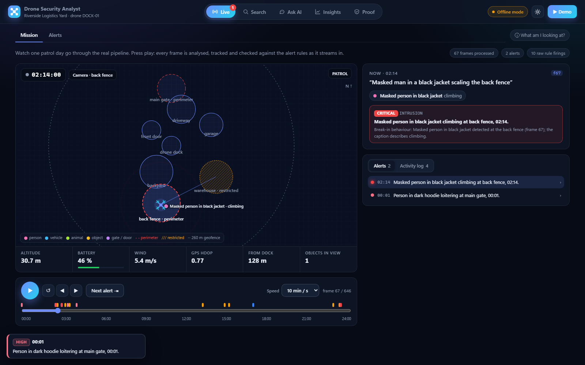
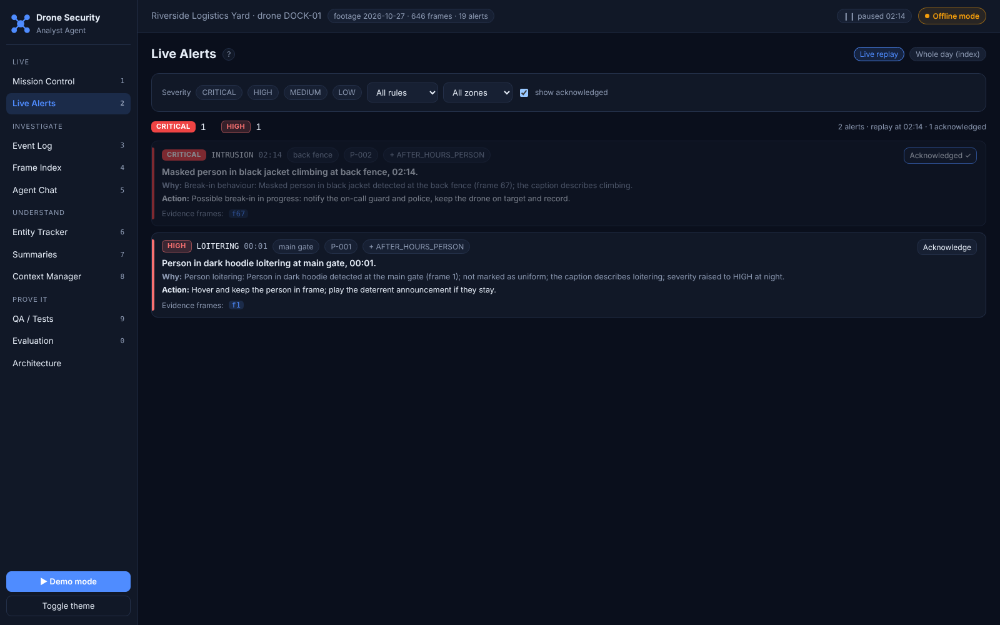
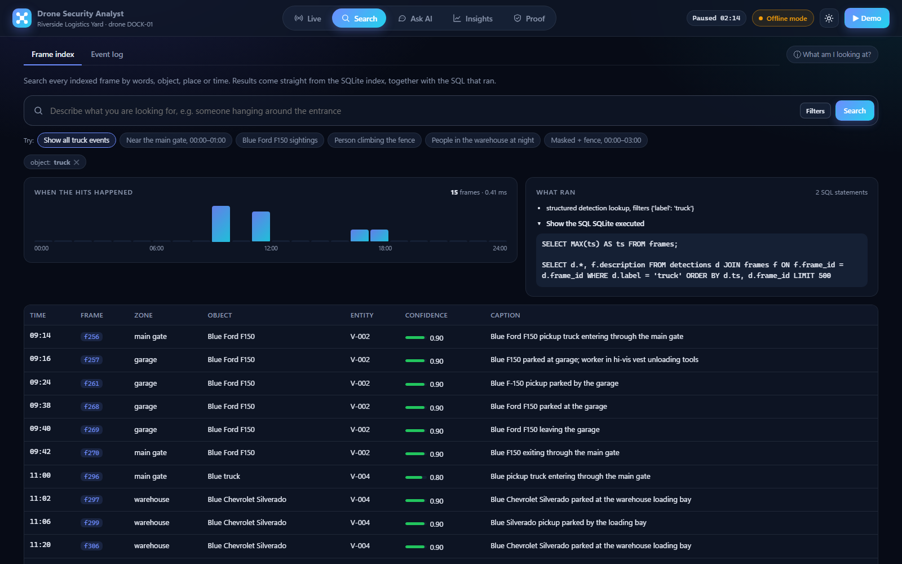
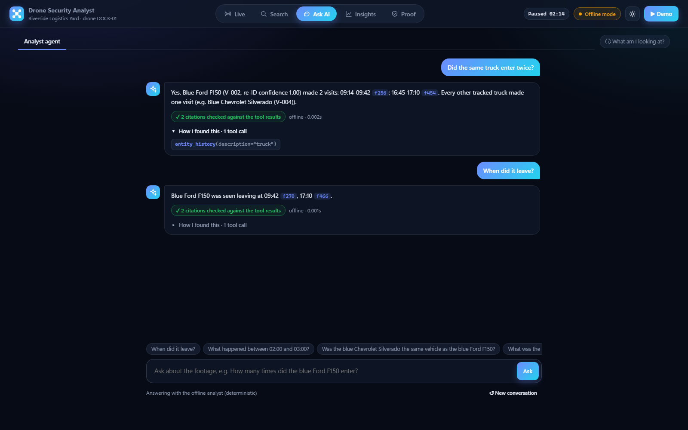
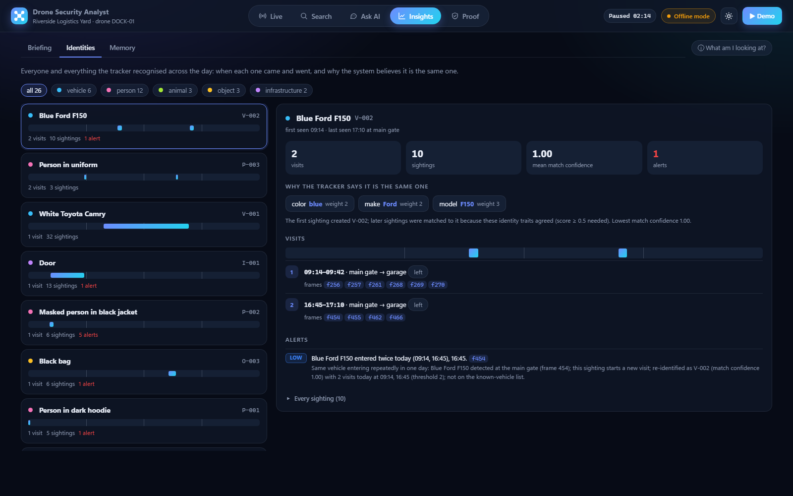
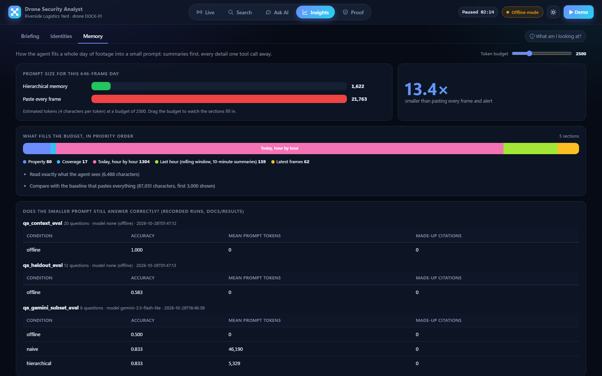
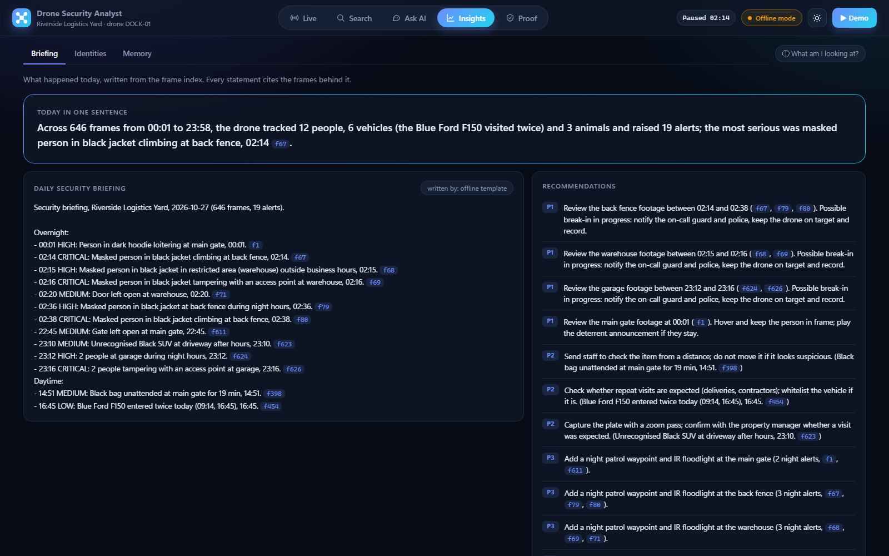
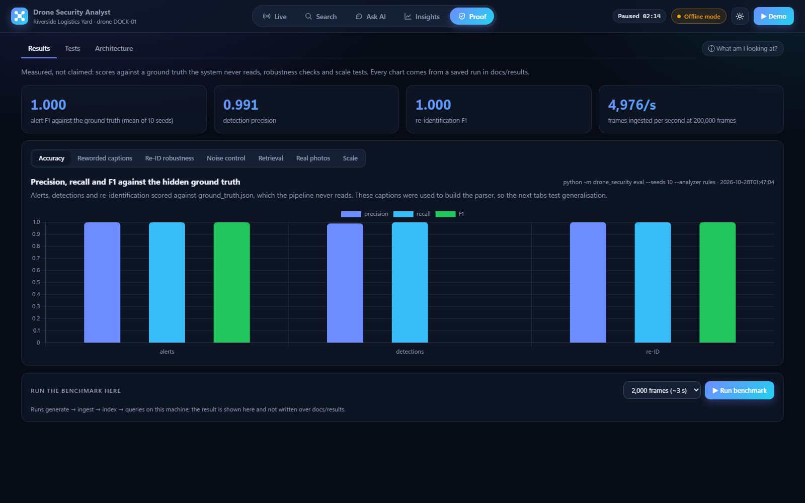
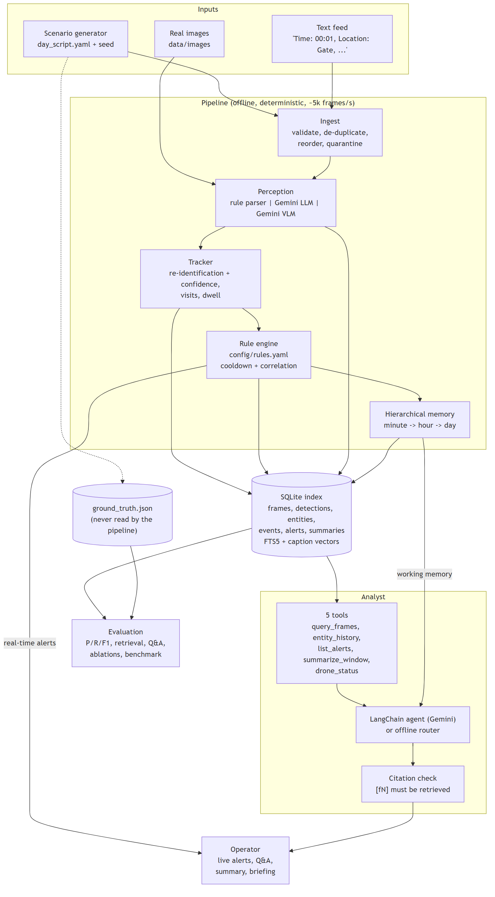

# Drone Security Analyst Agent

A security analyst for a **docked drone that patrols one property every day**. It reads the drone's
telemetry and video frames (simulated as text descriptions, or real images through a VLM), turns each frame
into structured objects, tracks who and what comes and goes, raises **explained real-time alerts**, indexes
every frame for search, and answers questions through an **agent that cites the frames it relies on**.

```
[02:14] ALERT  CRITICAL Masked person in black jacket climbing at back fence, 02:14.
        why: Break-in behaviour: Masked person in black jacket detected at the back fence (frame 67);
             the caption describes climbing.   evidence frames: [67]
[16:45] ALERT  LOW      Blue Ford F150 entered twice today (09:14, 16:45), 16:45.

you> How many times did the blue Ford F150 enter today?
Blue Ford F150 (V-002, re-ID confidence 1.00) made 2 visits with 10 sightings:
09:14-09:42 (main gate, garage) [f256]; 16:45-17:10 (main gate, garage) [f454].
you> When did it leave?
Blue Ford F150 was seen leaving at 09:42 [f270], 17:10 [f466].
you> What was the licence plate of the black SUV?
Not enough evidence in the footage to answer that. The frame descriptions never record licence plates.
```

| Document | |
|---|---|
| [docs/REPORT.md](docs/REPORT.md) / [REPORT.pdf](docs/REPORT.pdf) | Approach, assumptions, design choices, all results, error analysis, how AI tools helped |
| [docs/FEATURE_SPEC.md](docs/FEATURE_SPEC.md) | Value and the three key requirements with acceptance criteria |
| [docs/ARCHITECTURE.md](docs/ARCHITECTURE.md) | Components, data model, diagrams ([docs/diagrams](docs/diagrams)) |
| [docs/TESTING.md](docs/TESTING.md) | Test strategy, cases, scenarios, how to reproduce, latest results |
| [docs/results/](docs/results) | Raw outputs of every experiment (JSON + Markdown + plots) |

## Web UI (the fastest way to see everything)

```bash
make ui                     # or: python make.py ui   (or, after setup: python run_ui.py)
```

That one command creates the virtual environment if it is missing, processes the scenario day into
`data/runs/ui.db`, and opens **http://localhost:8000**. There is no npm and no build step, and it works fully
offline. Options: `python make.py ui --port 8001 --no-browser`. The top-right badge shows **Offline mode**,
or **Gemini · *model name*** when `GEMINI_API_KEY` is set (environment or `.env`). With a key, the agent
and the "Rewrite the briefing with Gemini" button use Gemini; alerts stay deterministic. Press **Demo**
(or `D`) for a 15-step guided tour that drives every view.

The console has five sections (keys `1`–`5`). Each opens on its main view, with the detail one click
away: sub-tabs, expandable alerts, "Show the SQL", "How I found this". **What am I looking at?** (top right)
explains each view and names the requirement it covers.

| Section › view | What it shows | Assignment requirement |
|---|---|---|
| **Live** › Mission | Replay of the day through the real pipeline: property map (zones, drone at its GPS fix, objects, the zone the camera is looking at), telemetry strip, player with alert ticks on the timeline, the current frame, live Alerts / Activity log feed | Process telemetry + frames; real-time alerts |
| **Live** › Alerts | Alerts newest first; click one for the reason, recommended action and evidence frames; severity filter with counts; rule / zone filters; acknowledge | Real-time alerts from predefined rules |
| **Search** › Frame index | One search bar (FTS5 + vectors) plus object / zone / entity / time filters shown as removable pills; example chips; hits per hour; **the SQL SQLite actually ran** | Frame-by-frame indexing |
| **Search** › Event log | The logged events ("Blue Ford F150 spotted at garage, 09:16.") with perception and re-ID confidence; filter, sort, click a row to open the frame | Identify and log objects/events |
| **Ask AI** | Chat with the analyst agent: clickable [fN] citations, a citation check on every answer, tool calls under "How I found this", "not enough evidence" | Bonus: Q&A agent |
| **Insights** › Briefing | One-sentence summary, daily briefing, recommendations, a 24-hour activity grid that drills down to ten-minute windows and raw frames | Bonus: video summarisation |
| **Insights** › Identities | Each re-identified entity: visits on a 24 h bar, match confidence, which traits matched (with weights), every sighting | Tracking / re-identification |
| **Insights** › Memory | The agent's prompt (sections and tokens, adjustable budget) against pasting every frame; recorded Q&A accuracy for both | Context management for long footage |
| **Proof** › Results | Headline scores, then one chart at a time from `docs/results/*.json` (P/R/F1 vs ground truth, reworded captions, re-ID robustness, noise control, retrieval, real photos, scale) + "Run benchmark" | Evaluation, scalability |
| **Proof** › Tests | Runs the pytest suite on the server; pass ring and pass/fail per group with test names | Testing |
| **Proof** › Architecture | The pipeline as clickable components, the diagrams in `docs/diagrams`, how the UI is wired | Design |

Clicking any frame reference (`f67`) opens the frame drawer: caption, detections with confidence, alerts it
raised or supports, telemetry, and "Show in replay". Links from the earlier one-page-per-screen layout
(`#/mission`, `#/chat`, ...) redirect to the matching view.

Every number on screen comes from the backend: the processed day, a live pipeline (the replay), or the saved
experiment outputs in `docs/results`. Nothing is mocked.

### How the UI is built

```
browser: src/drone_security/web/static/  (index.html, css/app.css, js/*.js ES modules, Chart.js 4.4.1 vendored)
   │  JSON  /api/status /api/alerts /api/events /api/frames/{id} /api/index/query /api/entities /api/summaries
   │        /api/context /api/results /api/tests/run /api/benchmark          (full list: /api/docs)
   │  SSE   /api/replay/stream?start=N&speed=S   a fresh SecurityPipeline per connection, one frame at a time
   │  SSE   POST /api/chat                       SecurityAnalyst.ask, then tool calls + answer + citation check
   ▼
FastAPI: src/drone_security/web/api.py (routes), state.py (processed day, agent), replay.py (live stream)
   ▼
the existing modules: pipeline, index, tracker, rules, retrieval, memory, agent, analysis, evaluation
```

* **Why plain HTML/JS instead of React:** no `npm install` means a fresh clone runs offline with one Python
  command, and every file can be read without a toolchain.
* **Why the replay re-runs the pipeline:** alerts on screen are raised by the rule engine at that moment.
  Seeking to a position re-processes the earlier frames without delays (the whole day takes about 0.3 s)
  because the tracker and cooldowns depend on history.
* **Honest limits:** the agent computes its answer first, then the server streams it in chunks (display
  streaming, not model token streaming). Objects are drawn at their detected zone, because captions give a
  zone, not coordinates.
* **Checks:** `tests/test_web_api.py` covers every endpoint; `python make.py ui-check` opens every view in
  headless Chromium, fails on console errors, runs the main flows (replay raises an alert, a query returns
  frames, the agent answers with citations, the test suite runs, the demo tour advances, both themes) and
  saves the screenshots below.

### Screenshots

| | |
|---|---|
|  Live: the 02:14 intrusion on the map |  Alerts with the reason, action and evidence |
|  "Show all truck events" with the SQL that ran |  Ask AI: checked citations and the tool calls behind them |
|  Identities: why the F150 was matched |  Memory: the agent's prompt vs pasting every frame |
|  Briefing: one sentence, daily briefing, recommendations |  Results from the saved runs |

All screenshots: [docs/screenshots](docs/screenshots).

## Quick start

Python 3.10+. Works offline; no API key needed.

```bash
git clone <repo-url> && cd <repo>
python make.py setup        # creates .venv and installs the package + test deps
python make.py test         # 154 tests
python make.py run          # process the scripted day: live logs, alerts, summary
python make.py demo         # 8-scene walkthrough in the terminal
python make.py eval         # offline experiments -> docs/results
python make.py benchmark    # 10k / 50k / 100k / 200k frames -> docs/results
```

`make <target>` does the same on Linux/macOS (the Makefile calls `make.py`). After `setup`, activate the
environment (`.venv\Scripts\activate` on Windows, `source .venv/bin/activate` elsewhere) and use the CLI,
`python -m drone_security <command>`:

```bash
python -m drone_security query --label truck                  # "show all truck events"
python -m drone_security query --text "person climbing the fence" --from 00:00 --to 06:00
python -m drone_security alerts --min-severity HIGH --explain
python -m drone_security ask "What happened between 23:00 and 23:30?"
python -m drone_security chat                                 # follow-up questions keep context
python -m drone_security summary                              # one sentence + daily briefing
python -m drone_security run --feed data/scenarios/sample_frames.txt   # the brief's text format
python -m drone_security run --speed 60 --explain             # replay as a live feed, 1 footage minute per second
```

### Gemini (optional)

Put the key in an environment variable or a gitignored `.env` file in the repo root:

```
GEMINI_API_KEY=your-key
```

With a key, the same commands use Gemini where it helps: `ask`/`chat` use the LangChain + Gemini agent,
`run --analyzer gemini` uses the LLM perception backend, `summary --llm` writes the briefing with Gemini, and
`python make.py eval-gemini` runs the Gemini experiments (model listing, VLM on real images, embeddings,
held-out wording, context experiment). The model is chosen by listing what the key can access; set
`GEMINI_MODEL` to override. Without a key, or if a call fails, everything falls back to the offline path.

## What it does (mapped to the assignment)

| Requirement | Implementation |
|---|---|
| Process telemetry + frames | Seeded scenario generator ([day_script.yaml](data/scenarios/day_script.yaml)): 646 frames with GPS, altitude, battery, wind, HDOP; robust ingest (validation, de-duplication, reorder buffer, missing telemetry); the brief's text format; real images via the Gemini VLM |
| Identify and log objects/events | Pluggable perception: lexicon parser (offline), Gemini LLM, Gemini VLM, all returning the same structured detections (category, label, colour, make, model, clothing, action, zone, confidence); re-identification with confidence; event log ("Blue Ford F150 spotted at garage, 12:00.") |
| Real-time alerts from predefined rules | 14 declarative rules in [config/rules.yaml](config/rules.yaml): intrusion, loitering (caption or measured dwell), restricted zone, after-hours person/vehicle, repeat vehicle, unattended object, gate/door open, battery, geofence, GPS drift, altitude, wind. Each alert: severity, rule id, time, evidence frame ids, explanation, recommended action; cooldown + correlation |
| Frame-by-frame index | SQLite: frames, detections, entities, events, alerts, summaries; indexes on time, object, zone, entity; FTS5 + caption vectors with hybrid (BM25 + vector) search |
| Bonus: summary + Q&A | One-sentence summary, daily briefing, agent with five tools (`query_frames`, `entity_history`, `list_alerts`, `summarize_window`, `drone_status`), frame citations checked, "not enough evidence" instead of guessing |

## Results (all from runs in this repo; raw data in docs/results)

| What | Result | Source |
|---|---|---|
| Alerts vs ground truth (20 incidents, 10 seeds, development captions) | precision 1.00, recall 1.00 | [eval_scenario_rules.md](docs/results/eval_scenario_rules.md) |
| Detections / re-identification (same runs) | P 0.991 / R 1.00; re-ID F1 1.00 | same |
| Re-ID with 25% of identity attributes dropped | F1 0.917 (this version) vs 0.430 (v1 matcher) | [ablation.md](docs/results/ablation.md) |
| Noise control | 19 alerts/day instead of 67.4 raw, same recall | same |
| Retrieval, 22 labelled queries | nDCG@10: hybrid 0.846, keyword 0.822, TF-IDF 0.768 | [retrieval_eval.md](docs/results/retrieval_eval.md) |
| Offline Q&A, held-out questions | 7/12 correct, 0 made-up citations (20/20 on the tuned dev set) | [qa_heldout_eval.md](docs/results/qa_heldout_eval.md) |
| Agent context at 200,000 frames | 2,442 tokens (hierarchical) vs 6,862,855 (every frame) | [benchmark.md](docs/results/benchmark.md) |
| Ingest at 200,000 frames (310 days) | 4,976 frames/s; indexed queries < 1 ms; DB 96.5 MB | same |
| Real-time budget per frame (parse, track, rules, index) | median 0.19 ms, p99 under 2 ms at 200,000 frames, even on battery | [benchmark_battery.md](docs/results/benchmark_battery.md) |
| **Gemini VLM on 7 real photos** (gemini-3.5-flash) | object recall 1.00 (8/8), no false alarms, expected alert on 7/7 images | [vlm_check.md](docs/results/vlm_check.md) |
| **Captions reworded by Gemini** (unseen wording) | alert F1: rule parser 0.769, Gemini analyzer 1.00 | [paraphrase_eval.md](docs/results/paraphrase_eval.md) |
| **Hybrid search with Gemini embeddings** | nDCG@10 0.889 (best); paraphrase queries 0.860 | [retrieval_eval.md](docs/results/retrieval_eval.md) |
| **Context: whole video in the prompt vs hierarchical memory + tools** (gemini-3.5-flash-lite, 6 questions) | both 5/6 correct; 46,190 vs 5,329 prompt tokens per question; 0 made-up citations | [qa_gemini_subset_eval.md](docs/results/qa_gemini_subset_eval.md) |

The 1.00 scores are on captions the parser was developed against; the held-out, ablation and reworded-caption
numbers are the ones that say how it generalises. The Gemini runs used a free-tier key (20 requests per model per
day), so each names its model and the Q&A experiment is a 6-question subset. See the report, sections 5-6.

## Architecture



```
src/drone_security/
  scenario.py        seeded day generator -> frames.jsonl + ground_truth.json
  ingest.py          validation, de-duplication, reorder buffer, text format
  perception/        rule parser + lexicon; Gemini LLM and VLM analyzers (same interface)
  tracking.py        re-identification with confidence, visits, dwell, evidence frames
  rules/engine.py    declarative rule engine (config/rules.yaml), cooldown, correlation
  indexing/          SQLite + FTS5 frame index
  retrieval.py       hybrid search: BM25 + TF-IDF / Gemini embeddings, reciprocal-rank fusion
  memory.py          hierarchical summaries (10-minute -> hour -> day), prompt rendering
  agent/             5 tools, offline router, LangChain + Gemini agent, citation check
  analysis.py        one-sentence summary, daily briefing, recommendations
  gemini.py          key handling, model selection, retries, token accounting
  evaluation/        ground-truth scoring, retrieval, Q&A/context, VLM, ablations, benchmark
  demo.py, cli.py    demo scenes and the command line
config/              property.json (zones, hours, known vehicles), rules.yaml
data/                scenario script + generated day, real images (+ licences), eval sets
tests/               154 tests (incl. web API and the brief's own examples)
run_ui.py            starts the web UI (src/drone_security/web/)
scripts/ui_check.py  headless browser check of every view -> docs/screenshots
```

Key design decisions (details and alternatives in the report, section 4):

* **Deterministic core, LLM at the edges.** Alerts never wait on the network; Gemini handles unusual wording,
  images and open questions, each with an offline fallback.
* **Rules as data.** Conditions explain themselves, so an alert's explanation is exactly the checks that passed.
* **SQLite + FTS5.** Embedded, zero-ops, runs on the dock; sub-millisecond indexed queries at 200k frames.
* **Hierarchical memory + tools** instead of pasting the video into the prompt: bounded context, drill-down on demand.
* **Measure against ground truth** that the system never sees.

## How AI tools were used

This project was built with **Claude Code** (Anthropic) working from the assignment text: it audited the first
version, planned the upgrade, wrote the code, tests, experiments and documents, ran every command, and fixed
what the measurements exposed. Claude Code also generated the whole web UI (FastAPI layer, frontend, API
tests, the headless UI check and the screenshots), and later redesigned it from eleven dense screens into five
sections that show the essentials first and the detail on demand. While wiring the chat it found that the offline
analyst answered "Did the same truck enter twice?" with a list of sightings; it fixed that with a test.
**Gemini** is part of the product (perception, Q&A, embeddings), not a development tool. What I reviewed and
own, especially the ground-truth design, thresholds, the re-identification trade-off and the honesty of the
reported numbers, is listed in the report, section 10.

## Limitations

* The main dataset is a scripted day; the perception numbers on it are optimistic (development set).
* Identity relies on appearance attributes from captions: no plates, no faces. A vague description of a
  returning vehicle is deliberately not matched (precision over recall), so some repeat visits are missed.
* The offline Q&A router is keyword-based and generalises poorly (7/12 held-out); open-ended questions need
  the Gemini agent.
* Q&A grading is regex-based on small question sets.
* No live video decoding or notification delivery. The web UI is a single-operator demo console (no login;
  alert acknowledgements live in the browser session only).
