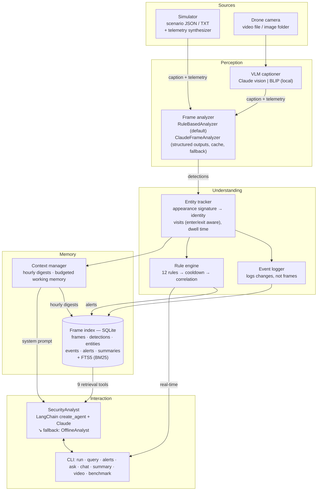
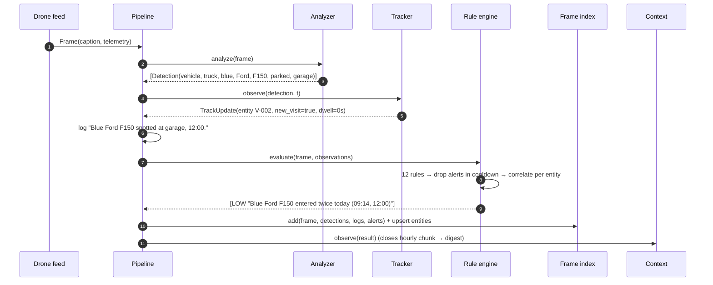
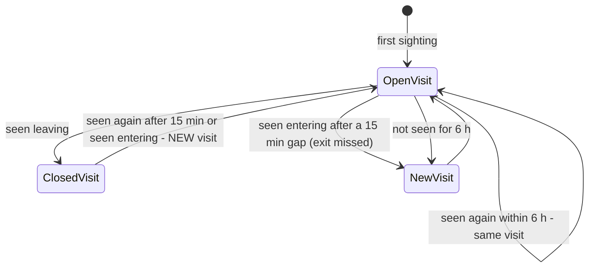
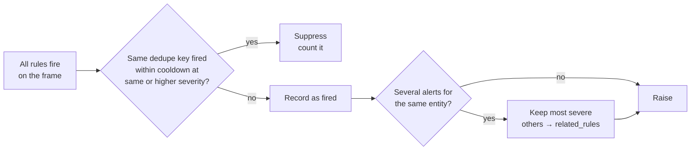
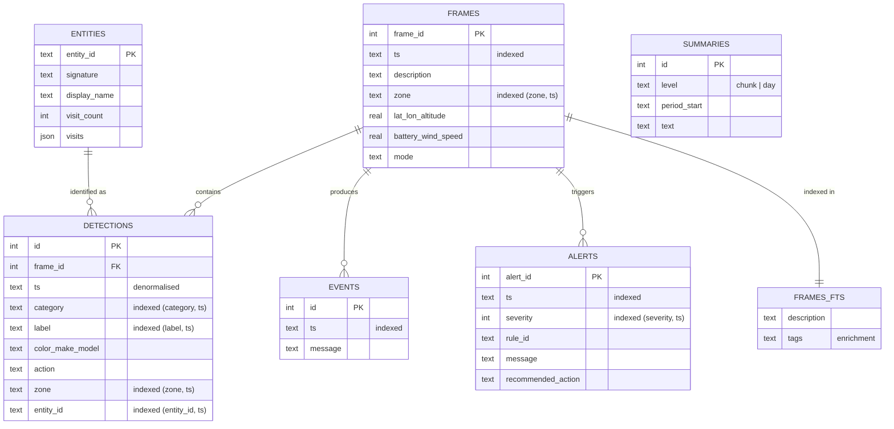
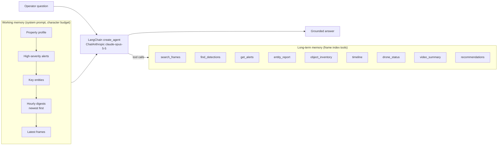
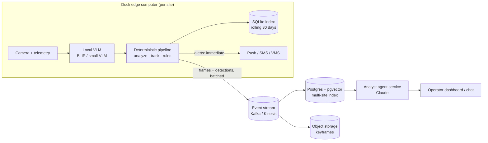

# Architecture

## 1. System overview

Each frame is processed exactly once, in order, by a single `SecurityPipeline.process(frame)` call. There is no shared mutable state outside the pipeline object, so one pipeline per drone scales horizontally.

## 2. Per-frame sequence

## 3. Components and the reasoning behind them

### 3.1 Ingestion: one representation for real and simulated footage

All footage becomes a `Frame(caption, telemetry)`. The simulator produces captions directly; real footage is sampled (one frame every *N* seconds, since consecutive frames at 30 fps are near-duplicates) and captioned by a VLM. Everything downstream is identical, so the VLM is a swappable component and the deterministic pipeline can be tested without images.

The **telemetry synthesizer** places the drone at each zone's GPS coordinates with jitter, derives heading and speed from consecutive fixes, models battery drain per sortie, and maps GPS back to zones with a haversine lookup. Any field can be overridden per frame to script safety events (battery 14 %, geofence breach, 8 m altitude, 12.4 m/s wind).

### 3.2 Perception

| Analyzer | When | Properties |
|---|---|---|
| `RuleBasedAnalyzer` | default; fallback for the LLM | Mention-based parser: finds entity mentions (vehicle models/types, people, animals, objects, open access points), reads modifiers before each (colour, make, count) and the action/zone after it, up to the next mention. Handles negation across lists ("no vehicles or people"), carried items ("person carrying a box" → attribute, not a second object), model spelling variants (F150 / F-150 / F 150). ~0.1 ms per caption. |
| `ClaudeFrameAnalyzer` | `--analyzer claude` | Claude structured outputs into a Pydantic schema (guaranteed-valid JSON). LRU cache keyed on caption + zone (patrol footage repeats heavily). Per-frame fallback to the rule parser on any error. |
| `ClaudeVisionCaptioner` / `BlipCaptioner` | `video` command | Security-focused captions: people (clothing, carried items, action), vehicles (colour, make/model, entering/leaving/parked), animals, open gates/doors. BLIP runs locally on the dock GPU; Claude gives richer detail. |

### 3.3 Tracking: identity over boxes

- **Signature**: vehicles by type/colour/make/model; people by clothing colour + clothing items (+ masked); anonymous people by zone, so two undescribed figures at opposite ends of the property don't merge.
- **Visits follow behaviour, not just time.** The first version split visits on a 15-minute gap; with 30-minute patrol passes, a truck that was parked the whole time was counted as entering again when it was next seen *leaving*. Visits now close on an observed exit and reopen on the next sighting or an observed entry.
- **Dwell time** accumulates only while the entity is observed continuously (consecutive sightings within 15 min, same zone). It drives the loitering rule independently of caption wording.

### 3.4 Rules: actionable, not noisy

| Rule | Severity | Fires when |
|---|---|---|
| R-SUSPICIOUS | CRITICAL / HIGH | climbing, tampering, peering; masked or carrying break-in tools |
| R-LOITER | HIGH night / MEDIUM day | caption describes loitering |
| R-DWELL | HIGH night / MEDIUM day | same person in one zone ≥ 5 min (perimeter only during business hours) |
| R-RESTRICTED | HIGH | person in a restricted zone outside business hours |
| R-NIGHT-PERSON | HIGH perimeter / MEDIUM elsewhere | person on site 22:00–06:00 (uniformed staff exempt) |
| R-VEHICLE-NIGHT | MEDIUM | non-whitelisted vehicle arrives at night |
| R-REPEAT-VEHICLE | LOW | non-whitelisted vehicle's *n*-th visit today (n ≥ 2) |
| R-ACCESS-OPEN | MEDIUM | gate/door open outside business hours |
| R-BATTERY | MEDIUM ≤ 25 % / HIGH ≤ 15 % | airborne |
| R-GEOFENCE | HIGH | drone farther than the geofence radius from the dock |
| R-ALTITUDE | MEDIUM | patrol altitude below minimum |
| R-WIND | MEDIUM | wind ≥ safe limit while airborne |

Cooldown keys are rule-specific: per entity for most rules, per entity *and action* for R-SUSPICIOUS (climbing → tampering is an escalation worth a new alert), per visit count for R-REPEAT-VEHICLE, per level for R-BATTERY (low → critical always fires). Thresholds, zones, hours and the whitelist live in `config/property.json`.

### 3.5 Frame index: SQLite + FTS5

- **Two ways in.** Structured queries are `(column, ts)` B-tree range scans ("all truck detections 09:00–13:00"). Full-text search is FTS5 with BM25 over the caption **plus enrichment tags** written by the analyzer (`vehicle truck pickup blue ford f150 parked garage`), so "truck" finds a frame captioned "Blue Ford F150 parked at garage".
- `ts` is denormalised onto detections so time-filtered object queries skip the join; values are stored lower-case so equality uses the index.
- WAL mode + batched commits; re-indexing a frame (e.g. re-captioned by a better VLM) replaces its derived rows.
- Why not a vector DB: captions are short and vocabulary-constrained, so BM25 plus synonym tags covers the query space at zero extra infrastructure. Image-embedding search (CLIP) is the natural next step for real footage (see the report).

### 3.6 Context management and the agent

- **Hierarchical summarisation**: the context manager closes a digest every hour of footage as frames stream in (template by default; any `Chunk -> str` summarizer, e.g. an LLM, can be plugged in, and a failing summarizer falls back to the template). Digests are also persisted to the index.
- **Budgeted rendering**: sections are added in priority order until the character budget is spent; truncated sections end with "… (n more, use the search tools)" so the model knows to retrieve. The same block can be rebuilt from the database (`render_from_index`) for questions asked after a run.
- **Agent**: LangChain `create_agent` with `ChatAnthropic(model="claude-opus-5-5", effort="medium")`, the 9 toolkit methods as `StructuredTool`s (docstrings are the tool descriptions), and the full message history kept between turns for follow-ups.
- **Offline analyst**: the same tools behind a deterministic intent router (summary, recommendations, drone status, inventory, entity history, alerts, detections, timeline, full-text fallback), with time-window parsing ("between 23:00 and 23:59", "at night", "at 02:15") and pronoun follow-ups. `SecurityAnalyst` uses Claude when a key is configured and falls back per question on any failure.

## 4. Real-time behaviour

| Stage | Cost per frame (laptop, deterministic path) |
|---|---|
| Rule-based analysis | ~0.1 ms |
| Tracking + rules | ~0.05 ms |
| Index write (batched) | ~0.15 ms |
| **Total** | **~0.3 ms → 3,000–5,000 frames/s** |

A drone sampling one frame per second produces 86,400 frames a day; the deterministic pipeline processes that in about 30 seconds. When the Claude analyzer is enabled, caption caching and per-frame fallback keep the alert path from blocking on the network.

## 5. Scaling beyond the prototype

- Alerting stays at the edge (no network dependency); the cloud adds cross-site search, long retention, re-captioning with stronger VLMs and the conversational agent.
- The SQLite schema maps directly to Postgres; `frames_fts` becomes `tsvector` + GIN, and CLIP image embeddings go into pgvector for visual search.
- Per-site pipelines are independent (one tracker + rule engine per drone), so throughput scales with sites.
