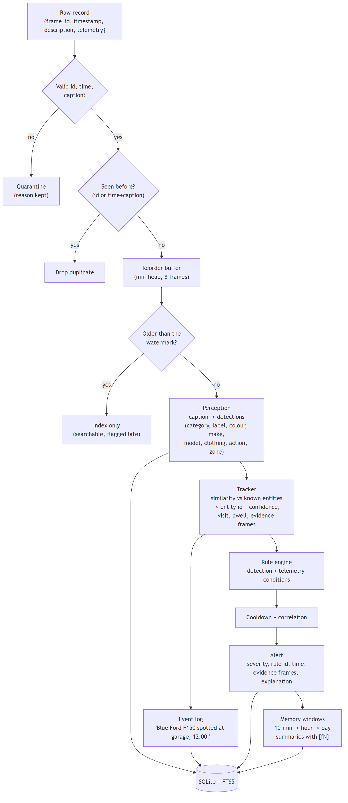
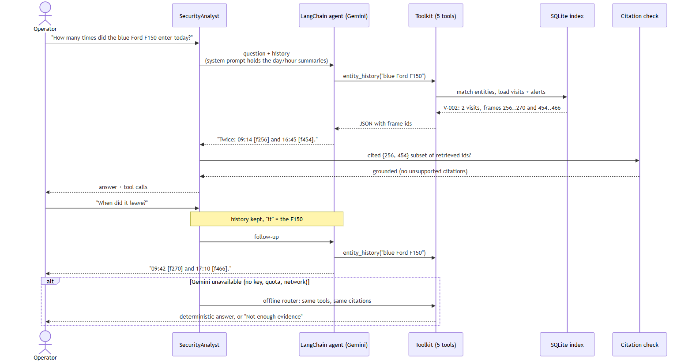

# Architecture

Diagrams (Mermaid source + SVG + PNG) are in [docs/diagrams](diagrams):
[architecture](diagrams/architecture.png), [data flow](diagrams/data_flow.png),
[agent sequence](diagrams/agent_sequence.png). Re-render with mermaid-cli:
`mmdc -i docs/diagrams/<name>.mmd -o docs/diagrams/<name>.svg`.

## Components

| Component | Module | Responsibility | Offline | With Gemini |
|---|---|---|---|---|
| Scenario generator | `scenario.py` | Day script (YAML) + seed -> frame records and a separate ground truth | yes | - |
| Ingest | `ingest.py` | Validate, quarantine, de-duplicate, reorder (heap of 8), parse the brief's text format; telemetry optional | yes | - |
| Perception | `perception/` | Frame -> `Detection` (category, label, colour, make, model, attributes, action, zone, count, confidence) | lexicon parser | LLM over captions (batched, cached), VLM over images |
| Tracker | `tracking.py` | Re-identification by attribute similarity + continuity, confidence, visits, dwell, evidence frame ids | yes | - |
| Rule engine | `rules/engine.py` + `config/rules.yaml` | 14 declarative rules; explanation = clauses of the conditions that held; cooldown, escalation, correlation | yes | - |
| Frame index | `indexing/frame_index.py` | SQLite tables + FTS5; structured, full-text and telemetry queries | yes | - |
| Retrieval | `retrieval.py` | Hybrid search: BM25 + caption vectors, reciprocal-rank fusion | TF-IDF vectors | Gemini embeddings (cached in SQLite) |
| Memory | `memory.py` | 10-minute -> hour -> day summaries with `[fN]` citations; budgeted prompt context | templates | Gemini writes hour/day summaries |
| Agent | `agent/` | 5 tools, offline router, LangChain agent, citation check | offline router | LangChain `create_agent` + `ChatGoogleGenerativeAI` |
| Analysis | `analysis.py` | One-sentence summary, daily briefing, recommendations | templates | Gemini rewrites the briefing |
| Evaluation | `evaluation/` | Ground-truth scoring, retrieval, Q&A/context, VLM, ablations, paraphrases, benchmark | yes | Gemini conditions |

## Per-frame flow

1. **Ingest.** A record without a usable id, time or caption is quarantined with a reason. Broken telemetry
   is dropped but the caption is kept. Duplicates (same id, or same time and caption) are dropped. Frames
   pass through an 8-frame min-heap so small reorderings are absorbed.
2. **Watermark.** A frame older than the newest processed frame cannot be fed to the tracker (dwell and visits
   would run backwards); it is indexed and searchable, flagged `late`, and raises no alerts.
3. **Perception** produces detections. The zone comes from the caption ("at the garage") or else the drone's
   GPS zone; with neither it is `unknown`.
4. **Tracking** scores each detection against the active entities of the same category: attribute agreement
   (+weight) and conflict (-2x weight) over colour, make, model (vehicles) or colour, clothing, mask (people);
   +0.6 continuity if seen in the same zone within 15 minutes; an entity that left is only matched on strong
   evidence. Best score >= 0.5 wins; confidence = best - 0.5 x runner-up.
5. **Event log**: only changes are logged (new visit, zone change, notable action), so a parked truck seen 20
   times is one line.
6. **Rules** evaluate detection-scope rules per object and telemetry-scope rules per frame (with the GPS jump
   speed derived from the previous fix). Cooldown suppresses repeats unless severity rises; correlation keeps
   the most severe alert per entity per frame and lists the others in `related_rules`.
7. **Index + memory**: everything is written to SQLite; the memory closes 10-minute windows, hours and days as
   time passes.

## Data model (SQLite)

| Table | Key columns | Indexes |
|---|---|---|
| `frames` | frame_id, ts, description, zone, lat, lon, altitude_m, battery_pct, wind_mps, gps_hdop, mode, distance_from_home_m, late | ts; (zone, ts) |
| `detections` | frame_id, ts, category, label, color, make, model, action, zone, attributes, count, confidence, entity_id, track_confidence | (label, ts); (category, ts); (entity_id, ts); (zone, ts); frame_id |
| `frames_fts` | FTS5 over description + tags (category, label, synonyms, colour, make, model, action, zone, alert names) | porter stemming |
| `entities` | entity_id, signature, category, display_name, first/last seen, sightings, visit_count, mean_confidence, latest 30 visits (JSON) | (category, last_seen) |
| `events` | ts, frame_id, entity_id, zone, kind, message | ts; (entity_id, ts) |
| `alerts` | ts, frame_id, rule_id, severity, message, explanation, evidence_frame_ids, zone, entity_id, recommended_action, related_rules | ts; (severity, ts); (rule_id, ts); entity_id |
| `summaries` | level (minute/hour/day), period_start, period_end, text, frame_ids | (level, period_start) |
| `caption_vectors` | text_hash, model, vector (created by the Gemini embedder) | primary key |

Times are stored as `YYYY-MM-DD HH:MM:SS` text so range scans use the B-tree indexes; bare clock times in
queries ("00:01") refer to the latest footage day.

## Agent

| Tool | Answers | Returns |
|---|---|---|
| `query_frames(text, object, zone, start, end)` | "show all truck events", "person with a ladder", frames in a window | frame ids, times, zones, captions, entity ids |
| `entity_history(description)` | "how many times did the F150 come", "when did it leave" | visits with start/end/zones/frame ids, sightings, re-ID confidence, known-vehicle owner, alerts |
| `list_alerts(min_severity, rule_id, zone, start, end)` | "any intrusions at night?" | alerts with explanation and evidence frame ids |
| `summarize_window(start, end)` | "what happened between 23:00 and 23:30", "what objects were seen" | day/hour/10-minute summaries for the window, object inventory with first frame |
| `drone_status(time)` | battery/altitude/GPS at a time, or the day's extremes and flight-safety alerts | telemetry with frame id |

The system prompt holds the hierarchical working memory (property, coverage, today's non-quiet hours,
rolling last hour, latest frames, earlier days) within a token budget. The agent must cite `[fN]`; after
each answer, `check_citations` compares the cited ids with every id the tools returned this turn plus those
in the prompt, and reports unsupported ones. The offline router uses the same tools and abstains unless the
evidence covers the question.

## Web UI

A thin layer with no core logic of its own: FastAPI routes in `src/drone_security/web/` (`api.py` routes,
`state.py` shared state, `replay.py` live replay) call the modules above, and a plain HTML + ES-module
frontend in `web/static/` draws the results (no build step; Chart.js 4.4.1 vendored with its licence). The
live replay is a Server-Sent Events stream: each connection runs its own `SecurityPipeline` on the scenario
feed, so alerts on screen are raised by the rule engine at that moment, not read from a list.

| View | Backend |
|---|---|
| Live › Mission (replay) | `ingest.read_records`, `ingest.FeedSanitizer`, `pipeline.SecurityPipeline.process` (per frame, live), `config.PropertyConfig` (zones, lat/lon) |
| Live › Alerts | alerts from the live replay (`FrameResult.alerts`); full day from `FrameIndex.alerts` |
| Search › Event log | `FrameIndex.events` joined with `detections` (confidence, re-ID confidence) |
| Frame detail | `FrameIndex.query_frames(frame_ids=…)`, `query_detections`, `alerts`, `events` |
| Search › Frame index | `FrameIndex.query_detections`, `query_frames`, `retrieval.HybridRetriever.search`; the SQL shown is captured with `sqlite3.set_trace_callback` while the query runs |
| Ask AI | `agent.SecurityAnalyst.ask` (Gemini agent when a key is set, else offline), `agent.check_citations` |
| Insights › Identities | `FrameIndex.entities`, `query_detections(entity_id=…)`, `alerts(entity_id=…)`, tracker weights from `tracking.py` |
| Insights › Briefing | `analysis.summarize_video`, `daily_briefing`, `recommend`, `FrameIndex.summaries(level)` |
| Insights › Memory | `memory.render_from_index`, `render_naive`, `estimate_tokens`; saved `docs/results/qa_*_eval.json` |
| Proof › Tests | `pytest --junitxml` in a subprocess, parsed per test file |
| Proof › Results | saved `docs/results/*.json`; `evaluation.benchmark.run_benchmark` with a small size |
| Proof › Architecture | `docs/diagrams/*.svg` |

Data shapes (JSON):

* Frame: `{frame_id, ts, description, zone, lat, lon, altitude_m, battery_pct, wind_mps, gps_hdop, mode, distance_from_home_m}`
* Detection: `{category, label, display_name, color, make, model, action, zone, attributes[], confidence, entity_id, track_confidence}`
* Alert: `{ts, frame_id, rule_id, severity_name, message, explanation, evidence_frame_ids[], zone, entity_id, recommended_action, related_rules[]}`
* SSE replay events: `snapshot` (on connect: position, alerts so far), `frame` (frame, detections, logs, alerts), `end`.

Where the backend did not have what a view needed:

* Event logs store no confidence: the API joins the detection row of the same frame and entity.
* Entities store no "why matched" text: the API returns the identity traits with the tracker's weights, the
  mean re-ID confidence and the per-sighting confidences.
* Captions give a zone, not exact object positions: the map draws objects at their detected zone and says so.
* The agent computes the whole answer before returning it: the UI streams the computed answer in chunks over
  SSE, with the tool calls sent first (display streaming, not model token streaming).
* Alert acknowledgement is not part of the backend: it is kept in the browser session only.

## Extension points

* **New rule:** add an entry to `config/rules.yaml` using existing conditions; a new kind of condition is one
  function in `rules/engine.py` that returns an explanation clause or `None`.
* **New perception backend:** any object with `name` and `analyze(frame) -> list[Detection]` (e.g. an object
  detector on video frames).
* **New property:** `config/property.json` (zones, hours, known vehicles, tracker settings).
* **Cloud deployment:** the schema maps to Postgres + pgvector; the toolkit API stays the same.
