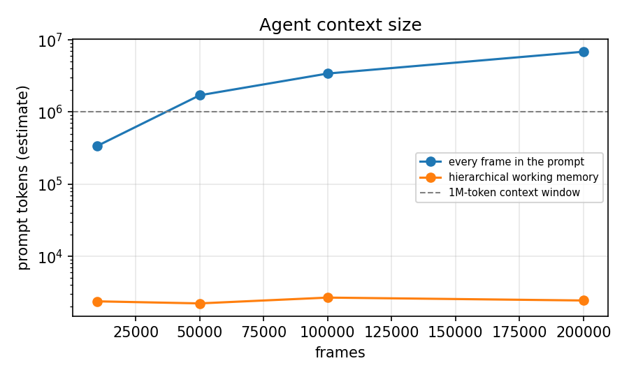
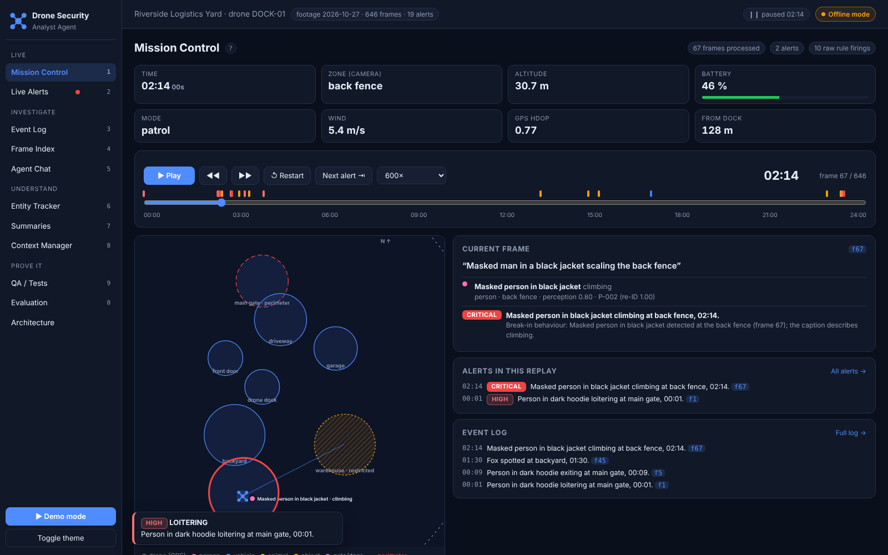
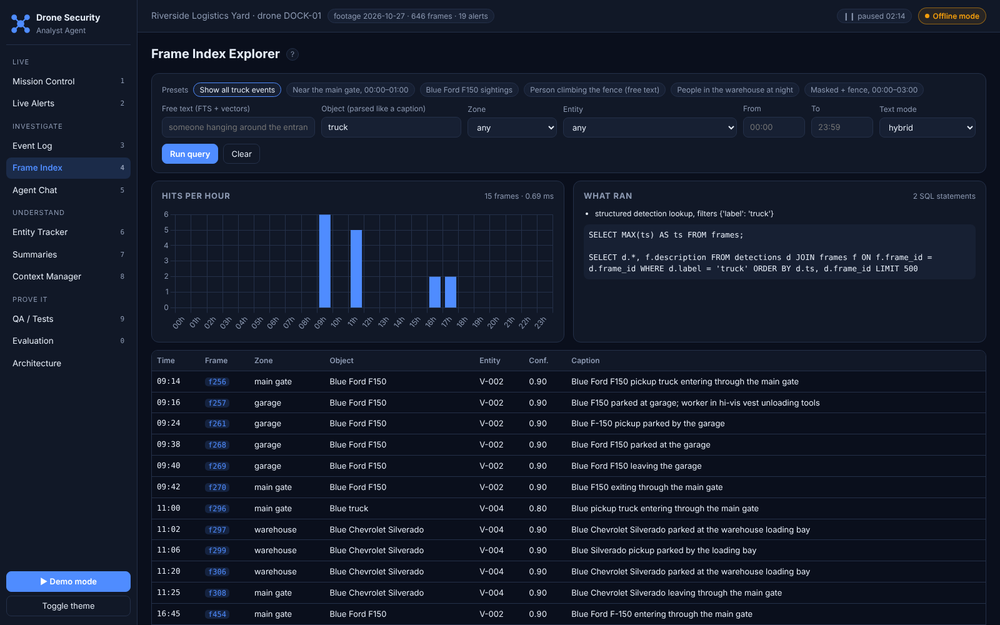

# Drone Security Analyst Agent: Report

*FlytBase AI Engineer assignment. Source of `docs/REPORT.pdf`. Every number in this report was produced by a
command in this repository; the raw output is in `docs/results/` and each table names the file it comes from.*

## 1. Summary

A docked drone patrols one property every day. This prototype turns its feed (telemetry + frame
descriptions or real images) into **explained real-time alerts, a searchable frame index, tracked
identities, and an analyst agent that answers questions with frame citations**.

What changed from the first version, in one line each:

* **Measured, not claimed.** A seeded scenario generator writes the frames and, separately, the ground truth
  (20 alert incidents, per-frame object identities). Alerts, detections, re-identification, retrieval and
  Q&A are all scored against it.
* **Declarative, explainable rules.** 14 rules in `config/rules.yaml`; every alert carries evidence frame
  ids and an explanation built from the exact conditions that fired.
* **Re-identification with confidence** instead of exact attribute matching.
* **Hierarchical memory** (10-minute -> hour -> day) so the agent's prompt stays ~2.4k tokens even at
  200,000 frames, where pasting every frame would need 6.9M.
* **Grounded agent**: five tools, `[fN]` citations checked against what the tools returned, and "not
  enough evidence" instead of guessing.
* **Gemini** (LLM, VLM, embeddings) behind the same interfaces as the offline components; everything
  runs offline without a key.

Headline results (offline, scripted day, 10 seeds; `docs/results/eval_scenario_rules.md`): alert precision
1.00 and recall 1.00 over 20 incidents, detection precision 0.991 and recall 1.00, re-identification F1 1.00.
These are **development-set** numbers: the parser was built against these captions. The held-out and
ablation results in section 5 are the more informative ones, and the live Gemini runs (5.6) show where the LLM
earns its place: on captions reworded by Gemini the parser's alert F1 drops to 0.769 while the Gemini analyzer
stays at 1.00; the VLM found 8/8 labelled objects in seven real photos with the expected alert on every one; and
the hierarchical memory answered as many questions as the whole-video prompt with 8.7x fewer prompt tokens.

## 2. Approach

```
records -> ingest -> perception -> tracker -> rule engine -> alerts (real time)
           (validate,  (parser |    (re-ID,     (rules.yaml,
            dedupe,     Gemini LLM | visits,     cooldown,
            reorder)    Gemini VLM) dwell)      correlation)
                   \________________________________________/
                                      |
                      SQLite index (frames, detections, entities, events, alerts,
                      summaries; FTS5; caption vectors) + hierarchical memory
                                      |
                 5 tools -> LangChain agent (Gemini) or offline router -> citation check
```


Diagrams: `docs/diagrams/architecture.png`, `data_flow.png`, `agent_sequence.png` (Mermaid sources next to them).

**Language as the contract.** The brief simulates video as text ("Frame 1: Blue truck at gate"). I kept
that as the interface between perception and everything else: a real camera frame becomes a caption plus
structured objects (Gemini VLM), a simulated frame arrives as a caption, and from there the path is
identical. The analytics are testable without images, and the index stores something both a person and
an LLM can read.

**Deterministic core, LLM at the edges.** Ingest, parsing, tracking, rules and indexing are deterministic
Python and run at ~5,000 frames/s on a laptop, so alerts never wait on the network. Gemini is used where
language understanding pays off: unusual caption wording, real images, open-ended questions and prose
summaries. Every Gemini component has an offline fallback (parser per frame, offline analyst per
question, template summaries), so a network or quota failure degrades answers but never stops alerts.

**Measure everything.** The scenario generator is the backbone: `data/scenarios/day_script.yaml` describes
one day as data (patrol route, dock windows, scenes, 18 scripted episodes, 20 expected incidents, 7 benign
traps). `python -m drone_security generate` writes `frames.jsonl` (what the drone sends) and
`ground_truth.json` (what really happened) to separate files; the pipeline never reads the truth.

## 3. Assumptions

| Assumption | Why |
|---|---|
| Frames arrive as captions + telemetry; real images go through a VLM first | Matches the brief; one path for simulated and real input |
| One property, one drone, local time; multi-day footage supported | A docked-drone deployment; the benchmark runs 310 consecutive days |
| A scripted day with paraphrased captions is the primary dataset | No public dataset combines drone telemetry, captions and labelled security incidents for one site; scripting gives exact ground truth |
| Identity = appearance attributes (colour, make, model, clothing, masked) | Captions carry no plates or faces; enough to show re-identification logic and its limits |
| Telemetry: GPS, altitude, battery, wind, HDOP; zone derived from GPS | Drives the drone-health rules; telemetry can be missing per frame |
| Night 22:00-06:00, business hours 08:00-19:00, loiter 5 min, unattended 15 min, cooldown 15 min | Typical for a commercial yard; all in `config/` |
| Uniformed people and whitelisted vehicles are authorised | Stands in for badge/plate whitelists |

## 4. Design choices and why

| Choice | Alternatives | Reasoning |
|---|---|---|
| **Gemini** for LLM, VLM and embeddings | Claude, GPT-4o, local BLIP/LLaVA | The assignment asked for Gemini. One key covers text, images and embeddings; Flash models are fast and multimodal. The model is **not hard-coded**: `select_models()` lists the models the key can use and picks the newest stable Flash model (override with `GEMINI_MODEL`); the choice is saved to `docs/results/gemini_models.json` |
| **Structured output** (Pydantic schema) for perception | Prompt for JSON and parse | Schema-validated responses, no parsing failures; the model's words are normalised onto the parser's vocabulary so both backends are scored the same way |
| **Batched, cached** LLM perception | One call per frame | Patrol footage repeats captions: a day has 646 frames but ~200 distinct captions, analysed in 40-caption batches |
| **Declarative YAML rules** with a fixed condition vocabulary | Python rule classes (v1), a general expression language | Rules are data an operator can read and tune; a small vocabulary keeps them safe to load and lets each condition explain itself, so explanations cannot drift from the logic |
| **Cooldown + correlation** | Fire every rule every frame | Measured: 67.4 alerts/day without them, 19 with them, same recall (`ablation.md`) |
| **SQLite + FTS5** | Postgres, Elasticsearch, a vector DB | Embedded, zero-ops, ships with Python, runs on the dock. B-tree indexes on (label, ts), (zone, ts), (entity, ts) keep structured queries under 1 ms at 200k frames; FTS5/BM25 over captions + analyzer tags finds "pickup" in "Blue Ford F150". Caption vectors live in the same file. The schema maps to Postgres + pgvector |
| **Hybrid retrieval** (BM25 + vectors, reciprocal-rank fusion) | Keyword only, vector only | Measured: hybrid has the best nDCG@10 (0.846 vs 0.822 keyword, 0.768 TF-IDF); RRF needs no score calibration |
| **Similarity re-identification** with confidence | Exact attribute signature (v1), learned embeddings | Agreement/conflict scoring over attributes plus continuity; a vehicle that left is only re-identified on strong evidence (make/model). Measured robustness gain below. Learned appearance embeddings need real images per track |
| **LangChain `create_agent`** with 5 narrow tools | Hand-written loop, many fine-grained tools, LangGraph custom graph | The brief asks for LangChain; a standard tool loop is easy to explain and replace. Five tools that each return frame ids keep the model's choices simple and every answer checkable |
| **Hierarchical memory** in the prompt + drill-down tools | Whole video in the prompt; pure RAG with no overview | The prompt always shows the shape of the day (alerts, busy hours) at bounded size; detail is one tool call away. Measured below |
| **Citation check** after every answer | Trust the prompt instruction | Turns "grounded" into a number: citations not returned by any tool are counted as made up |

## 5. Results

### 5.1 Alerts, detections, re-identification against ground truth

`python -m drone_security eval --seeds 10` -> `docs/results/eval_scenario_rules.md` (rule parser, seeds 1-10).

| Metric | Mean | Min | Max |
|---|---|---|---|
| Alert precision / recall / F1 (20 incidents) | 1.00 / 1.00 / 1.00 | 1.00 | 1.00 |
| Detection precision / recall | 0.991 / 1.00 | 0.991 | 1.00 |
| Re-identification precision / recall (pairwise) | 1.00 / 1.00 | 1.00 | 1.00 |

Every seed raised 19 alerts for 20 incidents (one alert covers two: the midnight loiterer's LOITERING alert
also carries AFTER_HOURS_PERSON via correlation), with one redundant alert, and the first matching alert
came 0.6 minutes after the incident start on average. Attribute accuracy on detected objects (seed 7):
colour 1.00, make 0.979, model 0.979, action 0.833. The single detection false positive per seed is
"Two workers loading **boxes** onto a yellow forklift": the parser reports the boxes as a package.

Example alert, as produced (seed 7):

> **CRITICAL INTRUSION** 02:14 "Masked person in black jacket climbing at back fence, 02:14."
> *Why:* Break-in behaviour: Masked person in black jacket detected at the back fence (frame 67); the
> caption describes climbing. *Evidence:* [67]. *Action:* notify the on-call guard and police, keep the
> drone on target and record.

> **LOW REPEAT_VEHICLE** 16:45 "Blue Ford F150 entered twice today (09:14, 16:45), 16:45." *Why:* ...
> re-identified as V-002 (match confidence 1.00) with 2 visits today at 09:14, 16:45 (threshold 2).
> *Evidence:* [256, 454, ...].

**Why these numbers are optimistic.** The lexicon parser was developed against this script; three of its
rules came from errors this evaluation found (post-noun negation "person no longer visible", "door handles"
as tampering, "door still open"). The blue Chevrolet Silverado decoy is never merged with the F150, but
every seed uses the same paraphrase pool. Sections 5.2-5.4 test the components under conditions they were
not tuned for.

### 5.2 Re-identification when perception loses detail

`python -m drone_security ablation` -> `docs/results/ablation.md`. Each identity attribute of every
detection is dropped with probability p (simulating vaguer captions); mean of seeds 1-5; 18 true entities.

| p | Tracker | Re-ID precision | Re-ID recall | Re-ID F1 | Entities | F150 repeat alert found | False repeat alerts |
|---|---|---|---|---|---|---|---|
| 0.1 | similarity (this version) | 0.999 | 0.967 | **0.982** | 18.4 | 1.0 | 0 |
| 0.1 | exact signature (v1) | 1.000 | 0.614 | 0.757 | 27.8 | 0.6 | 0.8 |
| 0.25 | similarity | 0.996 | 0.857 | **0.917** | 21.8 | 0.6 | 0.4 |
| 0.25 | exact signature (v1) | 1.000 | 0.276 | 0.430 | 35.4 | 0.4 | 1.8 |
| 0.5 | similarity | 0.988 | 0.510 | **0.670** | 31.6 | 0.0 | 1.0 |
| 0.5 | exact signature (v1) | 0.937 | 0.126 | 0.222 | 40.0 | 0.4 | 1.6 |

The similarity tracker keeps precision near 1.0 and degrades gracefully; the v1 matcher fragments
identities as soon as one attribute is missing. **Failure analysis:** at p = 0.5 the new tracker misses the
F150's repeat entry in every seed. When the second arrival is described only as "a blue pickup", the
returning-entity rule correctly refuses to call it the F150 (it could be the Silverado), so a new entity is
created and no repeat is counted. That is the intended trade-off (precision over recall for identity
claims), but it means repeat-visitor alerts depend on the camera reading make/model or a plate.

### 5.3 Retrieval: keyword vs semantic vs hybrid

`python -m drone_security eval-retrieval` -> `docs/results/retrieval_eval.md`. 22 labelled queries; relevance
from ground-truth entities, not caption words; half the queries are deliberate paraphrases.

| Method | hit@10 | MRR | nDCG@10 | nDCG exact (10) | nDCG paraphrase (11) |
|---|---|---|---|---|---|
| Keyword (FTS5/BM25 + tags) | 0.795 | 0.909 | 0.822 | 0.863 | 0.768 |
| Semantic (TF-IDF, offline) | 0.742 | 0.864 | 0.768 | 0.928 | 0.641 |
| **Hybrid (BM25 + TF-IDF, RRF)** | **0.852** | 0.886 | **0.846** | **0.969** | 0.734 |

Hybrid wins overall. TF-IDF fixes spelling variants ("F-150 pickup": 0.36 keyword -> 0.82 hybrid) but it is
lexical, not semantic: "someone hanging around the entrance late at night" and "break-in at the warehouse"
score 0 for every offline method because they share no words with "person loitering at the main gate" or
"forcing the warehouse side door". With Gemini embeddings the first is recovered and the hybrid reaches
nDCG@10 0.889 (section 5.6).

### 5.4 Context management and Q&A

`python -m drone_security eval-qa` (+ `--heldout`) -> `docs/results/qa_context_eval.md`, `qa_heldout_eval.md`;
`python -m drone_security benchmark` -> `docs/results/benchmark.md`.

| Footage | Hierarchical working memory | Every frame + alert in the prompt | Ratio |
|---|---|---|---|
| 1 day, 646 frames | 1,622 tokens | 21,763 tokens | 13x |
| 10,000 frames (16 days) | 2,376 | 339,316 | 143x |
| 100,000 frames (155 days) | 2,678 | 3,416,763 | 1,276x |
| 200,000 frames (310 days) | 2,442 | 6,862,855 | 2,810x |



(Token counts estimated at 4 characters per token.) The naive prompt passes a 1M-token context window at
~30k frames, about seven weeks of patrols; the hierarchical memory stays flat because older days collapse to
one line each and detail is fetched with `summarize_window` / `query_frames`.

Offline analyst (no LLM) on the fixed questions:

| Question set | Accuracy | Abstained correctly | Answers with made-up citations |
|---|---|---|---|
| Development (20 questions, the router was tuned on these) | 20/20 | 2/2 | 0 |
| **Held-out (12 questions, scored once, no tuning)** | **7/12 (0.583)** | 1/1 | 0 |

The held-out score is the honest one: keyword routing does not generalise. Of the five misses, three are safe
abstentions ("when did the drone dock after the incident", "which vehicle was parked in the late morning",
"which zones are on the property") and two are wrong-but-cited ("did the gardener trigger alerts" lists all
19 alerts; "what happened in the hour after the gate was left open" needs relative-time reasoning). This is
the gap the LLM agent fills: the Gemini agent answered both wrong-but-cited questions correctly (section 5.6).

### 5.5 Scale

`python -m drone_security benchmark` -> `docs/results/benchmark.md`, plots `benchmark_*.png`. Single process,
SQLite file on a laptop SSD (Intel Core, Windows 11, Python 3.10).

| Frames | Days | Ingest frames/s | DB size | Object query | Object+zone+time | One-day summaries | Hybrid text | Entity history |
|---|---|---|---|---|---|---|---|---|
| 10,000 | 16 | 6,310 | 4.9 MB | 0.58 ms | 0.08 ms | 0.09 ms | 0.44 ms | 0.50 ms |
| 50,000 | 78 | 5,400 | 24.1 MB | 0.57 ms | 0.08 ms | 0.08 ms | 0.88 ms | 1.38 ms |
| 100,000 | 155 | 5,202 | 48.2 MB | 0.57 ms | 0.08 ms | 0.11 ms | 3.84 ms | 2.35 ms |
| 200,000 | 310 | 4,976 | 96.5 MB | 0.58 ms | 0.08 ms | 0.09 ms | 7.20 ms | 7.30 ms |

(Median of 30 repeats; p95 in the results file.) **Throughput depends on the laptop's power state:** the same
commit ingested 10,000 frames at 6,310 frames/s on the run above and at 2,541 frames/s later the same morning on
battery (CPU held at 2.1 GHz). Ratios and latency trends are the meaningful part; absolute numbers are this
laptop's. Per-frame processing time, the real-time budget for alerts, was measured on the battery re-run from a
fresh clone (`benchmark_battery.md`): median 0.19 ms and p99 under 2 ms at every size up to 200,000 frames.
Indexed lookups are flat. Full-text and entity-history
latency grow with the number of matching rows (the same intruder appears every simulated day) but stay under
8 ms. **The first 200k run found three real scaling bugs**, fixed before these numbers: entity rows were
re-serialising every past visit on each sighting (ingest fell to 2,470 frames/s), the one-day summary query
had no indexable lower bound (9 ms), and hybrid search counted every table on each query (66 ms).

### 5.6 Gemini results (live API)

Run on 28 Oct 2026 with a **free-tier key** (20 requests per model per day). That limit shaped what was run:
`python -m drone_security models` listed 46 models and chose **gemini-3.8-flash** (newest stable Flash;
`docs/results/gemini_models.json`), but its daily quota was used up by the first, hung VLM run (see below) and the
model then returned `503 UNAVAILABLE` (overloaded) for the rest of the day. Each result therefore names its model:
perception on **gemini-3.5-flash**, the Q&A experiment on **gemini-3.5-flash-lite**, retrieval on
**gemini-embedding-2**. The Q&A experiment uses 6 questions chosen before the run
(`data/eval/qa_gemini_subset.yaml`) instead of all 32, and two conditions instead of four.

**VLM on seven real photographs** (`vlm_check.md`, gemini-3.5-flash, hand labels in `data/images/manifest.json`):

| | Object recall | Attribute accuracy | Images with false alarms | Expected alert behaviour |
|---|---|---|---|---|
| Gemini VLM, structured output | **1.00** (8/8) | 1.00 | 0 / 7 | 7 / 7 |
| Rule parser on the VLM's caption | 0.857 | 1.00 | 0 / 7 | |

The fence climbers at 02:14 raised INTRUSION, the black SUV at 23:10 raised AFTER_HOURS_VEHICLE, and the fox, parcel,
traffic, forklift and empty lane raised nothing, exactly as labelled. The VLM read makes and models (Ford F150,
Hyundai Sonata, Dodge Ram, Cadillac Escalade). Errors worth knowing: it reads lettering as a vehicle make ("Komatsu"
forklift, "Panus" container truck), and it repeats the zone named in the prompt ("near the main gate") rather than
inferring it from the image. The parser on the VLM's own caption missed the Escalade (make/model not in its lexicon),
which is the case for structured VLM output over caption parsing. Mean latency 14.6 s per image (7 requests, 10.9k
prompt tokens): fine for alerts on sampled frames, not for every video frame.

**Perception on unseen wording** (`paraphrase_eval.md`): gemini-3.5-flash reworded all 85 distinct captions of the
day (646 frames) keeping the facts, e.g. "Person in a dark hoodie loitering at the main gate" -> "Individual wearing
a dark hooded sweatshirt lingering near the main gate". Ground truth unchanged.

| Analyzer | Captions | Alert P | Alert R | Alert F1 | Detection P | Detection R | Action accuracy |
|---|---|---|---|---|---|---|---|
| Rule parser | original | 1.00 | 1.00 | 1.00 | 0.991 | 1.000 | 0.833 |
| Rule parser | **reworded** | 0.789 | 0.750 | **0.769** | 0.837 | 0.759 | 0.269 |
| Gemini LLM (gemini-3.5-flash) | original | 1.00 | 1.00 | 1.00 | 1.000 | 0.981 | 0.936 |
| Gemini LLM | **reworded** | 1.00 | 1.00 | **1.00** | 0.938 | 0.981 | 0.897 |

This is the clearest result of the project. On wording it was tuned for, the parser is as good as the LLM; on
wording it has never seen it misses 5 of 20 incidents (three intrusions, the open warehouse door) and raises 4
false alerts (a rephrased guard without the word "uniform" becomes an after-hours person), while the Gemini analyzer
keeps every incident and raises none. Cost: 3 batched requests of up to 35 captions per day of footage, thanks to
caption caching.

**Embeddings in hybrid retrieval** (`retrieval_eval.md`, 22 labelled queries, nDCG@10):

| Method | All | Exact (10) | Paraphrase (11) | Median latency |
|---|---|---|---|---|
| Keyword (BM25) | 0.822 | 0.863 | 0.768 | 0.3 ms |
| Hybrid BM25 + TF-IDF (offline) | 0.846 | 0.969 | 0.734 | 0.8 ms |
| Gemini embeddings only | 0.685 | 0.618 | 0.789 | 510 ms |
| **Hybrid BM25 + Gemini** | **0.889** | 0.940 | **0.860** | 558 ms |

Gemini vectors recover the paraphrase every offline method missed ("someone hanging around the entrance late at
night": 0 -> 1.00 alone, 0.70 hybrid) but fail single-word exact queries on their own ("gardener", "delivery van":
0.00), which is exactly why the hybrid wins. "Break-in at the warehouse" still scores 0: the system returns the
open-door frames, which my labels count only for the door, not the intruder, so part of that miss is label strictness.
The latency is one embedding call per query; the offline hybrid remains the default.

**Context management** (`qa_gemini_subset_eval.md`, gemini-3.5-flash-lite, 6 questions):

| Condition | Correct | Mean prompt tokens / question | Mean latency | Answers with made-up citations |
|---|---|---|---|---|
| Offline router | 3 / 6 | 0 | 0 s | 0 |
| Whole video in the prompt (naive) | 5 / 6 | 46,190 | 12.5 s | 0 |
| **Hierarchical memory + tools** | **5 / 6** | **5,329** | **7.1 s** | 0 |

Same accuracy at **8.7x fewer prompt tokens** and lower latency, on a day where the naive prompt still fits; at
200k frames it would not fit at all (section 5.4). Both Gemini conditions answered the two held-out questions the
offline router failed ("vehicle parked at the warehouse in the late morning", "what happened in the hour after the
gate was left open") with correct citations; the hierarchical agent answered four questions from its summaries
alone and called a tool for the other two. Both refused the licence-plate question. Both got "did the gardener
trigger any alerts?" wrong in the same way: they abstained instead of answering "no", because the memory calls him
"person in green cap" and absence of an alert is never stated explicitly. Gemini's own token count is about twice
the 4-characters-per-token estimate used elsewhere in this report (46,082 vs 21,763 for the naive context;
2,858 vs 1,622 for the hierarchical one), so absolute token figures in 5.4 understate real usage; the ratios hold.

**What the first live run broke** (all fixed, with tests): the SDK has no request timeout by default, so one stalled
call hung the VLM run for 10+ minutes and its retries used up the 3.8-flash quota; `gemini-embedding-2` merges a list
of strings into a single vector unless each text is sent as its own `Content`; and retrying a `429` whose
`retryDelay` is an hour only wastes time, so daily-quota errors now fail fast while burst limits are still retried.

## 6. Error analysis: what the failures teach

1. **Perception wording is the main risk.** Every development-set error came from wording the lexicon had not
   seen, and the reworded-caption test quantifies it: alert F1 1.00 -> 0.769 for the parser, 1.00 -> 1.00 for the
   Gemini analyzer (5.6). The fix is not a bigger lexicon but the LLM backend for unfamiliar wording
   (`--analyzer gemini`), with the parser kept as the fast, offline fallback.
2. **Identity needs strong attributes.** Re-identification is excellent when make/model/clothing are present
   and degrades predictably when they are not (5.2). A plate reader or appearance embeddings from real
   images are the next step; the tracker already exposes a confidence for each match.
3. **Rule windows matter more than rule logic.** The only alert errors seen during development were timing
   (a low-battery reminder 16 minutes after the first) and a missed negation, not wrong conditions.
   Persistent conditions now have longer cooldowns (battery 60 min, open gate 4 h).
4. **Deterministic routing does not generalise** (7/12 held-out). The offline analyst is a safety net that
   abstains rather than guesses; open-ended Q&A needs the LLM agent, which fixed the router's held-out misses.
5. **Context is cheap to bound, expensive to ignore.** A naive prompt is linear in footage length; the
   hierarchy is flat, and on one day it already matched the naive prompt's accuracy at 8.7x fewer tokens (5.6).
6. **Absence is hard to prove.** Both LLM conditions abstained on "did the gardener trigger any alerts?" instead of
   answering "no". Grounded agents need an explicit way to state negative evidence (e.g. a tool that answers
   "no alert involves entity X") rather than inferring it from silence.
7. **Live APIs fail in ways fakes do not.** The first live run found a missing request timeout, an embedding
   model that merges batched inputs, and wasteful retries on daily quotas; none showed up in the fake-client tests.

## 7. Testing

154 automated tests (`python make.py test`), described in `docs/TESTING.md`: unit tests for the parser, rules
(every rule, explanations, evidence, cooldown, escalation, correlation, YAML validation), tracker, index,
retrieval, memory and agent; scenario tests that score against ground truth; and edge cases (duplicates,
out-of-order and late frames, missing and broken telemetry, malformed records, midnight rollover, empty day,
the brief's text format). Gemini code paths are tested with fake clients (model selection, retries,
daily-quota fail-fast, per-text embeddings, normalisation, batching, fallbacks) and were then run live (5.6).

## 8. Web UI and demo videos

**Web UI.** `make ui` (or `python make.py ui`) processes the scenario day and serves a browser console at
http://localhost:8000. It works offline and needs no npm or build step; a badge shows "Offline mode" or
"Gemini: *model name*". It is a thin layer: FastAPI routes (`src/drone_security/web/`) call the existing
modules, and a plain HTML/JS frontend draws the results. Every number comes from the processed index, a live
pipeline, or the saved outputs in `docs/results`. Eleven screens cover the brief:

* **Mission Control** replays the day over Server-Sent Events. Each connection runs its own `SecurityPipeline`,
  so alerts are raised live by the rule engine. Seeking re-processes the earlier frames, because the tracker
  and cooldowns depend on history. The screen shows telemetry, a property map (zones, the drone's GPS
  fix, objects at their detected zone) and a scrubber with alert markers.
* **Live Alerts** shows severity, rule, zone, the explanation, the action and evidence frames, with filters and
  acknowledgement. **Event Log** has the brief-style log lines with confidence.
* **Frame Index Explorer** runs structured and full-text queries and shows the SQL SQLite actually executed
  (captured with `sqlite3.set_trace_callback`), with presets for "show all truck events" and "main gate,
  00:00-01:00".
* **Agent Chat** shows the tool calls, clickable [fN] citations and the citation check. **Entity Tracker**
  shows visits, match confidence and the identity traits that matched. **Summaries** shows the one-sentence
  summary, the briefing and the day → hour → 10-minute → frame tree. **Context Manager** shows the
  hierarchical prompt against the naive one.
* **QA / Tests** runs pytest from the browser. **Evaluation** charts the saved results and can run a small
  benchmark live. **Architecture** shows the diagrams. A **Demo mode** walks through all of it.

The API has its own tests (`tests/test_web_api.py`). `python make.py ui-check` opens every screen in headless
Chromium, fails on console errors, runs the main flows and saves `docs/screenshots/`. Wiring the chat exposed
one backend inaccuracy: the offline analyst answered the brief's "Did the same truck enter twice?" with a list
of truck sightings and lost the follow-up subject. It now checks every tracked identity of that kind for
repeat visits. A test covers the fix, and the dev and held-out Q&A scores did not change.





**Demo videos.** Recorded from the web UI (Demo mode) or from `python make.py demo`, following
`docs/DEMO_SCRIPT.md` (8 terminal scenes: feed, real-time alerts, rest of day, index queries, agent Q&A,
summaries, ground-truth scores, scalability; and the UI walkthrough). The video links are listed in
`SUBMISSION_CHECKLIST.md` once uploaded.

## 9. With more time

* **Real video**: sample frames from drone footage (e.g. 1 frame per 2 s), batch them through the VLM, and
  label a few hundred frames to measure perception properly.
* **Identity**: licence-plate reading and appearance embeddings per track to re-identify vehicles across days.
* **Learned rule thresholds**: per-zone, per-hour baselines (how normal is a person at the gate at 07:00?)
  to replace fixed thresholds.
* **Agent evaluation at scale**: a larger, independently written question set and an LLM-as-judge with
  human spot checks, instead of regex grading.
* **Production**: Postgres + pgvector for multi-site, an alert delivery channel, and authentication plus
  persisted acknowledgements for the web UI (today a single-operator demo console).

## 10. How AI tools helped (and what I must own)

**Claude Code (Anthropic) wrote most of this code**, working from the assignment text in an agentic session: it
audited the first version, proposed the P0/P1/P2 plan, wrote the modules, tests, experiments and these
documents, ran every command, and fixed what the runs revealed (the cross-thread SQLite crash, the three
scaling bugs, parser gaps found by the evaluation). The first version of the repository was also generated
with Claude Code, and so was the web UI (API layer, frontend, API tests, headless screen check). **Gemini** is part of the product (perception, Q&A, embeddings), not a development tool.

What I reviewed and decided myself, and what I need to be able to defend in an interview:

* **The scenario and its ground truth.** The expected incidents, windows and benign traps encode my
  judgement of what a correct system should do; the metrics are only as meaningful as these choices.
* **Thresholds and severities** in `config/rules.yaml` and `config/property.json` (loiter 5 min, unattended
  15 min, battery 25/15 %, cooldowns) are reasonable defaults, not tuned on real data.
* **Honesty of the results.** The 1.00 scores are development-set numbers; the held-out and ablation
  results are the ones that say how it generalises, and I report them as measured.
* **The re-identification trade-off** (refusing to call a vague "blue pickup" the F150) is a product decision:
  fewer false identity claims, some missed repeat visits.
* **Image licences** (`data/images/ATTRIBUTION.md`) and **key handling** (environment variable or gitignored
  `.env`, never logged).

AI made it possible to build and measure far more in two days than I could alone. It also produced code that
looked right and was wrong: the LLM agent crashed on its first tool call, the benchmark exposed quadratic
work, the first offline answer to "was the Silverado the same vehicle as the F150?" compared it with
the wrong car, and the Gemini client passed every fake-client test yet hung, merged embeddings and burned quota on
its first live run. Each was caught only because the system is measured end to end, against the real API.
